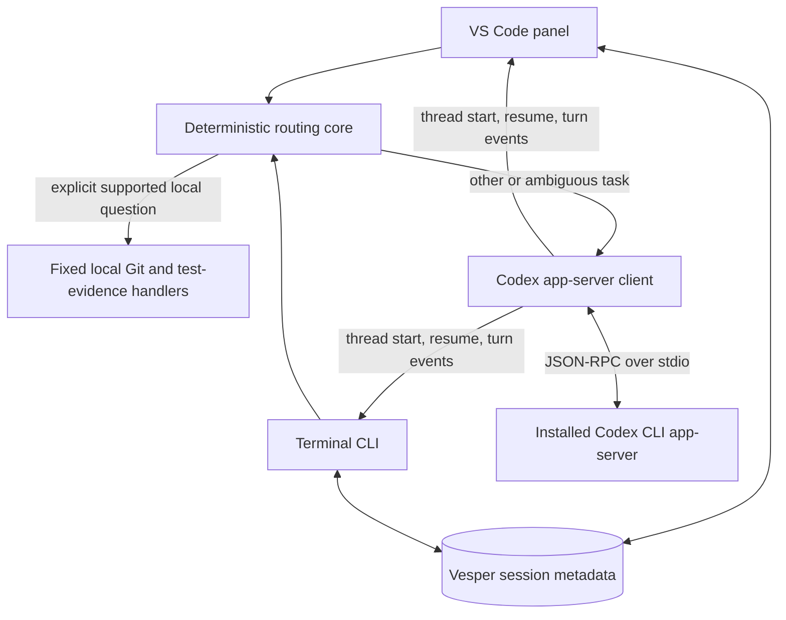

# Vesper

Vesper is a local-first coding-agent interface prototype. It combines a small VS Code conversation panel and a terminal CLI with deterministic local project checks and the Codex app-server as its current coding and reasoning runtime.

> **Project status:** the runnable implementation lives in [`experiments/fast-lane-app-server-poc`](experiments/fast-lane-app-server-poc/). It has extensive automated coverage, but authenticated, model-backed VS Code integration and real file-change workflows have not yet been validated end to end. Treat the project as an active prototype, not a production release.

## Current architecture



- **Two frontends, one runtime path:** the VS Code extension and `vesper` terminal CLI share the routing core, app-server client, and session store.
- **Local-first routing:** a narrow set of explicit Git and test-evidence questions is answered from local evidence. Unsupported or ambiguous requests go to Codex. Local answers do not start a model turn.
- **Codex app-server:** Vesper starts or resumes a Codex thread and streams turn events through the installed CLI's app-server using JSON-RPC over stdio. The app-server remains the coding and reasoning backend; Vesper is its interface and safety-aware adapter.
- **Session identity:** Vesper stores a session ID, canonical project path, Codex thread ID, schema version, and timestamps under `~/.vesper/sessions/` (or `$VESPER_HOME/sessions/`). It does not store prompts or model transcripts. The VS Code panel restores supported persisted history from the Codex thread; local answers are not part of that history.
- **Capability planning:** a normalized local catalog feeds a deterministic advisory planner, available from the CLI, terminal workspace, and VS Code panel. Planning preserves the router's decision, distinguishes unknown and stale runtime evidence, and never activates or executes a capability.
- **Bounded activity views:** command activity, per-item file-change evidence, and turn-level aggregate diffs have separate projections. They are correlated to their supported thread/turn/item identities, bounded, and escaped before display. An aggregate diff or proposed file change is not proof of a disk write.

## Safety boundaries

- The VS Code extension uses a read-only sandbox and declines approval requests. It does not silently create a replacement thread after a failed resume.
- The terminal does not automatically approve requests. It requires an explicit one-time decision when the server offers one; missing, stale, malformed, oversized, or mismatched file-change evidence fails closed.
- Rendering command or diff activity does not execute commands or authorize changes. Approval status and execution outcome remain separate.
- Local Git checks use repository evidence and do not contact a remote. Their limits and freshness are reported rather than inferred.
- Capability plans use local metadata and already observed passive MCP startup notifications. A ready notification does not prove an individual tool works; unknown and stale states remain explicit.

## Run the prototype

Requirements: Node.js 18 or newer, Git, and the Codex CLI on `PATH` for Codex-backed tasks. The prototype has no npm runtime dependencies.

```sh
cd experiments/fast-lane-app-server-poc
npm test
npm run cli -- --new /path/to/project
```

The CLI prints a Vesper session ID. Resume it with:

```sh
npm run cli -- --resume SESSION_ID /path/to/project
```

For the VS Code development host, isolated test homes, and the disposable fixture procedure, see the [prototype README](experiments/fast-lane-app-server-poc/README.md). The extension package is directly loadable from that folder; no build or VSIX is required.

## What is implemented

- Deterministic local routing for supported Git and test-result questions, with explicit evidence and uncertainty.
- Codex thread creation, streaming turns, interruption, resume, and bounded history restoration in the VS Code panel.
- Persistent project-to-session/thread mapping using Vesper's existing session store.
- Unified capability discovery and a deterministic plan preview with CLI, terminal, and VS Code entry points.
- Bounded command lifecycle visibility and terminal-safe rendering.
- Separate file-change approval evidence and aggregate turn-diff visibility, with fail-closed approval handling.
- Recovery states that distinguish connected, restoring, disconnected, and unavailable history/session cases.

## Planned direction

The next build steps extend this architecture rather than replace it:

1. Complete a visible, authenticated VS Code/app-server validation using the disposable project and isolated homes. Current automated app-server tests are mocked; live extension activation, model turns, and real file operations remain unverified.
2. Add project-scoped saved-session selection and older-turn history navigation while keeping Codex thread history authoritative and Vesper metadata minimal.
3. Improve conversation input and task-state UX, including multiline composition, clearer retry/interruption progress, and recovery feedback.
4. Expand tool and result visibility only after verifying each installed protocol event and its authorization boundaries. Keep command, file, and aggregate-diff evidence distinct.
5. Package and distribute Vesper after extension-host validation and core recovery flows are reliable.

Capability discovery and supported plugin/MCP management are implemented for the local sources and documented Codex interfaces already present. Automatic capability selection, skill activation, tool-health checks, model or sandbox settings editors, project memory, and ML engineering workflows remain future work and must preserve Codex's configuration and Vesper's approval boundaries.

## Project documentation

- [Prototype usage and extension setup](experiments/fast-lane-app-server-poc/README.md)
- [Interface inventory and roadmap](experiments/fast-lane-app-server-poc/INTERFACE-ROADMAP.md)
- [Reliability audit and validation history](experiments/fast-lane-app-server-poc/RELIABILITY-AUDIT.md)
- [TTY smoke and integration-readiness procedure](experiments/fast-lane-app-server-poc/TTY-INTEGRATION-READINESS.md)
- [Benchmark methodology](experiments/fast-lane-app-server-poc/benchmark/README.md)
